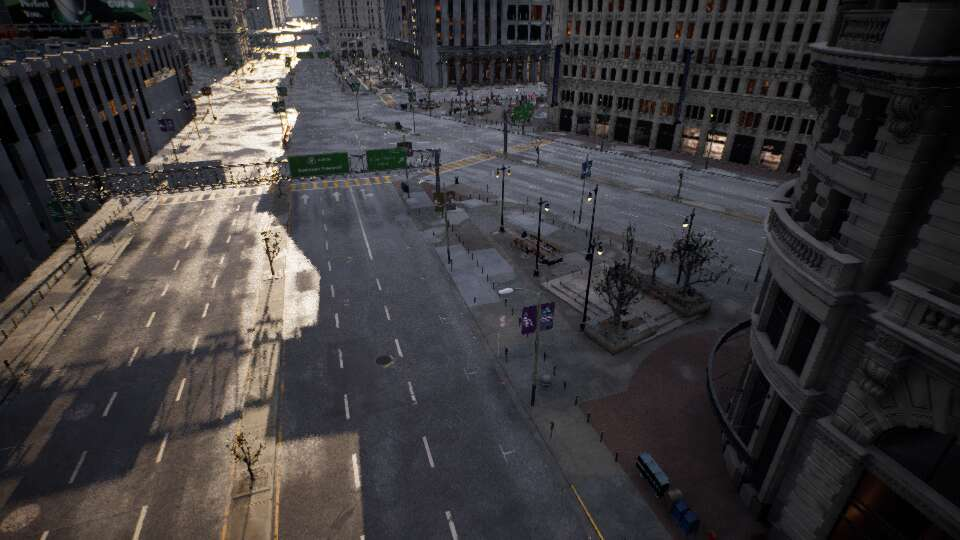

# 大城市独立试验场景

2026-10-31用户授权开始尝试接入。场景ID为 `city_large`，目标地图 `/Game/WISEYE/Scenes/city_large/BigCity`。小城市 `city` 的地图、设备配置与默认选择保留；根VBS仍只打开GUI。

## 资源与准备

F盘仍是代码源；本轮大型试验资源在内置盘 `E:\Projects\WISEYE-IR-Work` 生成，复用 `E:\Projects\Scene\CitySample` 的授权原始资源。F盘此前有模型目录读取损坏错误，因此不向其复制整个新地图。不要把E的共享资源目录联接当作独立副本删除；也不要删原始CitySample。

通过UE5.8的 `WorldPartitionRenameDuplicateBuilder` 创建地图副本，不使用 `-Rename`，不覆盖已有目标。复制会读取约10万外部Actor及其依赖，并生成首次Nanite/距离场缓存；准备阶段内存、耗时不能冒充实际运行性能。中途失败须检查日志和已生成副本，工具不会自动删掉重试。

准备工具为 `scripts/Prepare-BigCity.ps1`，每次显式指定单一阶段：

```powershell
powershell.exe -NoProfile -ExecutionPolicy Bypass -File F:\WISEYE-Studio\scripts\Prepare-BigCity.ps1 -Stage Build
powershell.exe -NoProfile -ExecutionPolicy Bypass -File F:\WISEYE-Studio\scripts\Prepare-BigCity.ps1 -Stage Duplicate
powershell.exe -NoProfile -ExecutionPolicy Bypass -File F:\WISEYE-Studio\scripts\Prepare-BigCity.ps1 -Stage Inspect
# 检查Saved/WISEYE/big_city/inspect.json，确认有效位置并编写city_large.json后：
powershell.exe -NoProfile -ExecutionPolicy Bypass -File F:\WISEYE-Studio\scripts\Prepare-BigCity.ps1 -Stage Assemble
# 初始布局未标定时，先通过运行时placement.snap得到FastGeo真实表面，
# 写回city_large.json的layout_surface_reference及Scene/Fleet坐标，再保存UE模型：
powershell.exe -NoProfile -ExecutionPolicy Bypass -File F:\WISEYE-Studio\scripts\Prepare-BigCity.ps1 -Stage Place
powershell.exe -NoProfile -ExecutionPolicy Bypass -File F:\WISEYE-Studio\scripts\Prepare-BigCity.ps1 -Stage Thermal
```

这不是空电脑的一键安装器；前提是当前衍生工程、原始下载与资源联接已经准备完成，且编译了最新Native代码。准备期间保持prepared=false；本轮实际验证通过后，已将F/E配置与正常preview-data的新场景标为prepared=true。Assemble只改WISEYE地图副本，移除其Mass人群/交通生成器及NightMode，安装标准1机1云台，保留提供的坐标和已有Fleet。不要用编辑器的简单Visibility射线覆盖已在运行时验证的高度。小城市原有楼顶布局不动。

本轮确实发现高度差：旧简单射线打到Z≈0下层代理；运行时FastGeo道路实际Z≈73cm。最初云台点还位于一栋约70m高建筑下方，不适合地面布置。最终改为广场/道路旁的运行时取点：云台锚点约(-72172.2657,-39996.5782,77.1168)cm，无人机初始点约(-70972.2656,-38796.5781,97.5888)cm；详见road-probe/resolved-layout.json。两设备默认相距约17m，是地面试验布局。Map中的默认设备模型位置也由Place阶段同步保存。

## 加载与功能边界

- 大城市专用运行流送源：每个云台基座、每架无人机独立注册；PlayerController继续跟随当前观察视角。初始试验每个源球形半径250m；不是全城常驻，也不是硬性内存上限，实际单元、依赖、非空间加载对象和HLOD仍会扩大加载量。
- 只对 `city_large` 应用该配置。小城市默认经济画质保持，大城市同样从经济画质开始。
- Native状态新增 `world_streaming_enabled`、`world_streaming_ready`、`device_streaming_sources`；大城市另有 `streaming_radius_m`。飞控等流送启用且初始设备分区完成后才创建物理对象。UE5.8的分区开关是受保护属性，由原生公开API检查；Python不绕过访问限制。此检查不证明任意远处都有完整碰撞，不是自动避障或分区加载过程中的自动刹车。
- 红外沿用用户认可的现有成像材质、独立光心及视轴差；热分类查询半径120m，但引擎还返回常驻/大包围盒对象，本轮实际检查33763个描述符、85708个组件，33570个组件打标，不能写成严格只加载120m。使用文件名/材质启发式，不是全城热物理建模。大范围飞行后的分类、远距遮挡和画面完整性须另测。
- 不将试验场景自动加入Shipping包。现有打包仍只含小城市，旧运行包未更新。
- 不提供真实测绘经纬度；大城市的仿真地理基准独立于city，默认未设置。
- 源码预览新增资源编译阶段：Native硬件状态带asset_compile_jobs；大城市桌面/预览监督器等待资源队列归零再提示就绪，等待上限15分钟。首次纹理/Nanite准备可能让CPU满载、画面低于1FPS，这是已实际观察到的阶段，不代表稳定运行帧率。新区域首次进入仍可能触发编译；Shipping预Cook未在本轮执行。
- 修复切图时飞控状态查询阻塞：50052状态读取物理actual_pose推送缓存，初始化仅一次GetGroundTruthKinematics；加入telemetry_valid/telemetry_age_s/telemetry_source，超过2秒保留最后位置并标记过期。避免旧地图销毁后的同步NNG请求阻塞事件循环60秒、拖住会话重连；不增加逐个输入命令的UE查询。
- 修复Python 3.14切图清理死锁：不在飞控监视循环外包`async with server`；退出先停止接收连接，再关闭Fleet持有的桌面长连接，最后等待TCP服务关闭。旧地图会话失效时跳过旧物理对象的远程取消调用。真实TCP空闲长连接的回归测试覆盖该顺序。
- 桌面切入大城市的重连确认上限为900秒，小城市保持90秒；源码初次启动大城市的地图加载等待也放宽至900秒。等待上限不是启动耗时承诺，长时间没有进展应检查日志。

## 验证

`tests/verify_big_city_live.py` 必须显式运行，会启动自己拥有的UE/GUI/飞控，用隔离数据测试初始分区、三路图像、起飞/悬停、短距离手动运动、降落与旋翼归零，记录硬件状态并关闭所属进程。支持 `--scene city` 做相同流程对照。运行前须把WISEYE_DATA_DIR指到隔离目录，复制配置并将Content联接到E衍生资源；不得用其改写用户日常Fleet。

2026-10-31本机源码预览验收通过，证据：`docs/evidence/big-city-20261031/final/report.json`及`summary.json`。真实流程为初始流送完成、三路图像检查、起飞、90秒飞行采样、手动移动约2.65m、降落、四RPM归零、切回city并恢复飞控、关闭所属进程。实际85次硬件样本；UE推进29.9998Hz，FPS中位29.9995、范围29.9909–30.0070。UE内存中位11.38GiB、系统总用量中位22.71GiB、UE显存中位4.05GiB。显存指标为引擎报告使用量，不等于整卡总占用。GPU型号Arc B580，CPU i5-14600KF，系统31.84GiB。

最后一轮源码启动138.22s，切回小城市35.13s；首次更冷的缓存准备曾约430s。这不是独立包启动性能。大地图复制约46分钟、外部Actor约8.69GiB，也不等于完整依赖、发布包增量或日常启动耗时。

107项核心测试、11项相关Qt测试通过，四个准备/启动PowerShell文件AST解析通过。用户F city Fleet、E正常preview-data city Fleet、原始Big地图SHA256与接入前一致，记录见preserved-hashes.json及preserved-hashes-after.json。没有把隔离测试Fleet写回用户city。

日常操作：根VBS打开GUI，在场景编排选择“City Sample · 大城市（试验）”，点击“启动仿真”；已有仿真时先降落，再加载所选场景。小城市始终默认。已有发布包仍只含小城市，本轮未Cook/重包/推送。新地图二进制在E衍生工程，原始授权资源仍通过联接复用，F仅代码和新配置；只复制F到另一台电脑不足以带走大城市。

未覆盖全城漫游、多机、多云台、长时间飞行、高画质、训练帧率、外部RTSP端到端时延或Shipping表现。250m为流送源形状，不能当作内存上限；新区域仍可能有编译/流送卡顿。小城市布局、仿真基准和当前红外算法保持；大城市热分类是初始街区的启发式适配，未做真实热物理校准。


