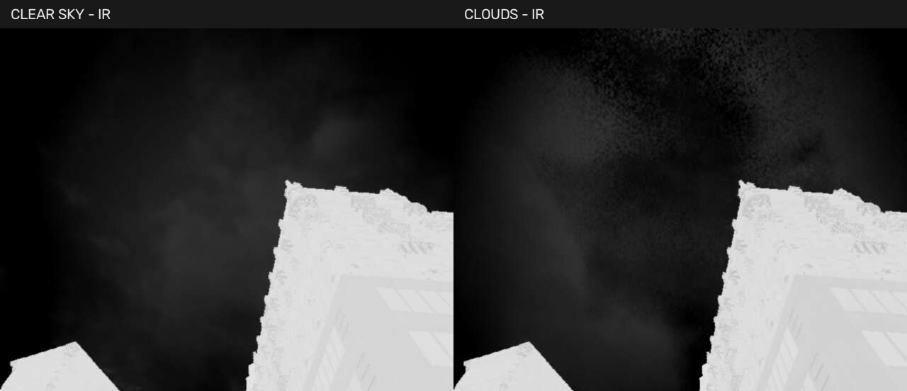
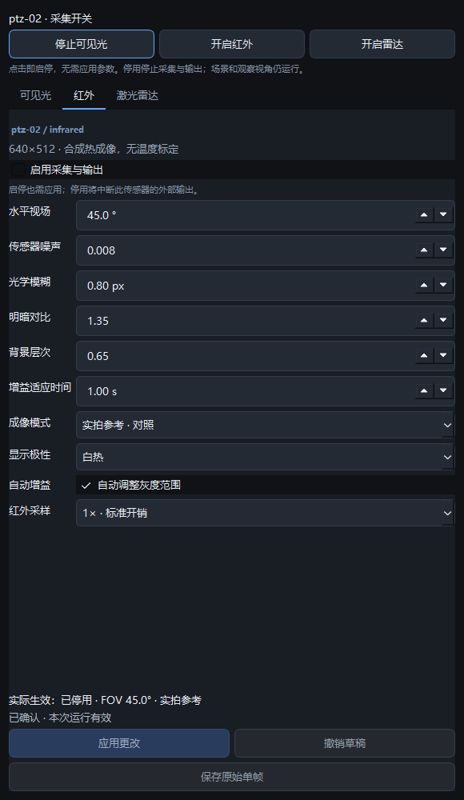

# 云层红外与传感器快捷启停

本轮源码入口仍为 `scripts/Start-InfraredPreview.ps1`。旧Shipping运行包尚未更新，不包含新开关协议和云量控制。

## 操作

选择需要操作的云台，在“传感器”页顶部点击可见光、红外、雷达的“开启/停止”。按钮立即提交该设备的启停，不需要再应用，也不提交其他参数草稿。灰色不可用表示未连接、设备状态尚未回读、旧版UE不支持或该传感器正在等待确认。参数页原有的“启用采集与输出＋应用”仍保留。

只用可见光时停止红外和雷达；用双光时开启可见光、红外并停止雷达。各云台独立，其他设备的传感器不随之关闭。本次运行有效，不改写Fleet初始配置。关闭一个画面窗只取消桌面订阅，不能代替停止传感器采集。

“环境与天气”增加云量0–100%。0移除WISEYE新增云层，场景原有天空仍保留；非0创建UE实际体积云，默认云底约1.5km、厚约1.5km。可见光/观察视角与红外复用同一处场景云。红外需选“楼宇热像 · 试验版”，建议白热、背景细节0.8、1×。云层有额外GPU开销，默认关闭，不自动降低其他设备画质。

## 资源边界

停用VIS/IR后停止额外SceneCapture渲染、GPU读回和JPEG/PSF/AGC工作，清空JPEG/诊断缓存，旧任务按版本失效，接口返回sensor_disabled。已经提交GPU的工作不能撤回，只允许收尾释放；重新开启等待新帧，不回传停用前缓存。

停用雷达后停止射线扫描并清空点云；scan_sequence供验证，未扫描时不增长。RTSP网关收到sensor_disabled后关闭该路FFmpeg，恢复采集后再创建编码器；低频探测保留。桌面现有订阅逻辑按enabled停取画面。基础场景、物理、观察画面、已开启设备和少量配置/RenderTarget内存仍保留，不能解释成UE整体GPU/显存归零。

## 成像边界与构建

楼宇模式利用实际渲染天空的亮度和色度估计云的灰度层次，不绘制固定屏幕云纹。这是白天外观代理，没有云高温度廓线、LWIR光学厚度、太阳/水汽辐射传输或实拍标定；夜间云可能不明显，不能用于物理测温或天气分析。未知天空物体、太阳和地平线可能影响此近似。后续可增加专用云光学厚度/温度通道。

`configure_infrared_facade.py`同时生成M_IR_Facade与自有M_Cloud_Runtime实例；后者引用引擎云材质，供Cook收集依赖，不修改原引擎资源。原分类/参考/Minimal资产和城市/Fleet不改。Prepare-ThermalCity -Apply包含该生成流程。新Shipping需要重新编译和Cook验证，不能直接拷贝开发DLL。

协议新增sensor.set_enabled（device_id、sensor=visible/infrared/lidar、enabled为严格布尔值），能力sensor_power_supported。environment.configure可选clouds数值[0,1]，缺省保留当前云量；能力environment.clouds_supported；environment.reset移除新增云层。

验收脚本：tests/verify_cloud_sensor_power_live.py。它验证同场景云开关图像、各采集组合、停用计数、另一云台继续输出、非法请求、快速开关恢复，并恢复参数、环境和云台；不飞行、不改Fleet。

## 2026-10-28 实测

Editor编译、60核心与23Qt测试通过。真实city同次运行的云开关图像、VIS-only/双光/IR-only/全停、捕获序号/输出停止、另一云台继续、快速开关和恢复全部通过。云层开启后IR平均变化10.52灰度，天空ROI P95-P5=44，天空虚假热目标0；这些只验证可见变化，不是逼真度评分。可见光与红外是先后捕获，不作为同步标定对。

还修复了远背景误判：旧100km阈值漏掉有限深度天空，且空自定义深度/Stencil误计约247k热目标像素。当前楼宇模式以10km远背景阈值处理天空，分类路径排除>=10km的自定义深度哨兵；超长距地形/目标需专门天空掩码和范围设计，不适用此城市近距近似。此前法线/材质标识试探未解决，未保留在最终实现。

额外完成原材料/Avata真实起飞、悬停、降落与热区域冷却回归，恢复型号/云台/环境/参数，最后飞控ready、四RPM为0；GUI状态截图也已恢复启停。用户Fleet和旧Minimal/Reference/Classified资产哈希不变，更新Facade并新增Cloud实例。所有本轮自有UE/飞控测试进程退出。详细证据与校验见[evidence](evidence/clouds-sensor-power-20261028/verification.json)。

云层仍有低采样颗粒、近楼偏白，尚未做夜间辐射/真实数据拟合、云层端到端延迟、长期多设备性能或新Cook验收。RTSP编码器释放做了Mock生命周期回归，未新做外部RTSP长测；旧运行包与GitHub未更新。场景本身仍可能有原有光追几何预算等告警，不承诺停掉一个传感器后整卡不再满载。
