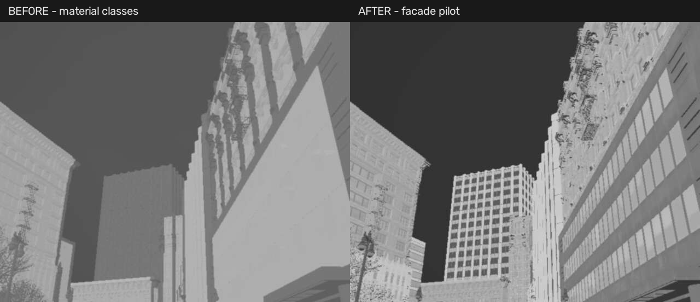

# 楼宇热红外外观试验

本轮以用户实拍拼图 b 的“暗天空、较亮楼体、立面和窗格灰度变化”为外观目标。参考拼图不进入代码库。它不能给出建筑温度、材质发射率、相机响应或采集条件，当前结果是工程外观代理，尚未证明与真实相机或 Anti-UAV 数据分布一致。

## 试用

主源码 `F:\WISEYE-Studio`，本机测试工程 `E:\Projects\WISEYE-IR-Work`。运行：

```powershell
powershell.exe -NoProfile -ExecutionPolicy Bypass -File "F:\WISEYE-Studio\scripts\Start-InfraredPreview.ps1"
```

加载城市后连接 UE，选择云台，打开传感器→红外，将成像模式设为“楼宇热像 · 试验版”并应用。默认仍为实拍参考，避免静默替换已有设置。推荐白热、1×、模糊0.8、对比度1.15、背景细节0.8，视场50°查看建筑；这些是试验参数，不是实拍相机标定值。背景细节0会关闭立面细节项；建筑底灰度仍与上一版不同。可随时切回材料热像和原三个模式。运行参数按云台隔离，不自动写入 Fleet。

## 实现范围

- 独立 `M_IR_Facade`，保留 `M_IR_Classified` / `M_IR_Reference` / 其他旧资产。优先加载Facade资产，其中旧模式分支保持可选；资产缺失时回退旧能力。
- deferred GBuffer BaseColor、Roughness与世界法线提供受限的材质纹理和表面方向差异。未知材料只在近似竖直表面加入楼体代理；已知道路、植被等保持分类预设。未知竖直物体可能被误当成立面，不能当语义分割结果。
- 不使用贴在屏幕上的假窗格，不复制可见光的室内灯光/阴影。颜色仍只是弱材质线索，不等同热辐射。
- 独立玻璃类别保留低信号预设。平滑表面线索不增加玻璃标签，也不代表解决了透明玻璃的深度、天空反射、LWIR不透射和发射率问题。
- 天空维持低信号，只加入很弱的现有天空亮度变化；不生成不存在的云层。保留FP16、640×512输出、CPU PSF/AGC与目标热区路径。

## 构建和复现

在已完成材料标签准备的构建副本中，运行 `ue5/scripts/configure_infrared_facade.py` 生成资产，再使用对应新Editor二进制。`Prepare-ThermalCity.ps1 -Apply` 会生成分类与楼宇两个材质并准备城市标签；默认不加Apply只审计。始终针对WISEYE城市副本，不能修改联接的原CitySample材质或整包保存共享资源。

实时验证脚本 `tests/verify_infrared_facade_live.py --output <证据目录>` 要求独立已运行的测试实例。它在两处固定方向对比可见光、classified、facade，检查输出尺寸、极性、细节参数、旧模式和短时性能，最后恢复传感器、环境和云台状态。它不飞行、不写Fleet。像素差异只证明功能生效，不是逼真度评分。

## 本机验证结果

Editor编译、58核心与18Qt测试通过。真实city运行标识见[完整报告](evidence/infrared-facade-20261027/report.json)中的run_id；两固定机位的640×512灰度、立面细节开关、黑白热与原参考/增强/原始模式检查通过，脚本恢复环境、云台和传感器。此次未进行新飞行测试。F用户Fleet与旧三个材料资产哈希不变，见[校验记录](evidence/infrared-facade-20261027/verification.json)。



可见原建筑中的窗格和条带得到保留，天空较暗；近处石材/装饰仍偏粗糙，玻璃类别缺少可靠覆盖，未进行真实域误差评分。初轮新版UE约30Hz、IR9.95Hz，缓存年龄P50约199ms；交替重复短测新版UE28.5–28.6Hz、IR9.34–9.90Hz、缓存P50 207–224ms、CPU读出11.2–12.5ms，对照classified UE29.5–29.8Hz、IR9.55–10.02Hz、缓存P50 198–199ms、CPU10.3–10.6ms。说明有额外开销，短测和缓存年龄不等于端到端/长期性能。见[重复采样](evidence/infrared-facade-20261027/performance-repeat.json)。旧VSM页池告警仍可能出现，本轮未修。

新Shipping包与GitHub尚未更新；旧运行包不含此模式。后续需用相同距离、视角、天气和曝光条件的真实连续视频做参数拟合，再处理透明/混合材质和热惯性模型。
