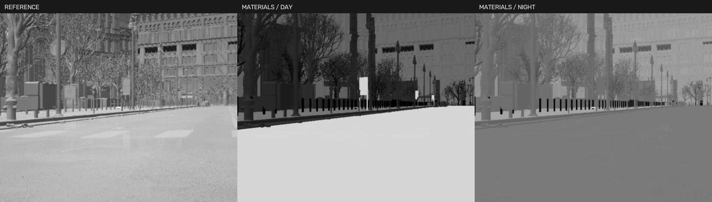

# 红外材料与局部热斑试验（2026-10-27）

本轮在第一版参考成像基础上，增加按网格/材质名称自动标记的背景类别、昼夜灰度预设和选定Avata的电机区域投影。只在内部盘的WISEYE城市衍生副本写入标签；用户F盘正式城市、设备位置、模型大小和原始CitySample不改。

当前是可比较的工程试验，不是物理辐射模型，也没有使用用户实拍拼图拟合温度或NETD。安装器、Shipping包与GitHub均未在本轮更新。

## 实现

新增独立 `/Game/WISEYE/Sensors/M_IR_Classified`。包含原有三种模式，另有 `thermal_profile=classified`，界面名称“材料热像 · 试验版”。默认仍为参考模式，材料热像需显式选择；旧运行时缺能力时禁用该选项。已标记副本使用新材质内的对照模式；完整回退旧二进制/旧材质时应使用未标记城市副本，旧公式不能直接解释新背景Stencil标签。

背景规则位于 `ue5/WISEYE/Config/WISEYE/thermal_material_classes.json`：

| 类别 | 日间信号 | 夜间信号 |
|---|---:|---:|
| 道路/沥青 | 0.38 | 0.25 |
| 砌体/混凝土 | 0.32 | 0.27 |
| 玻璃 | 0.16 | 0.15 |
| 植被 | 0.28 | 0.24 |
| 金属 | 0.24 | 0.20 |
| 水体 | 0.23 | 0.25 |

这些数值是0～1归一化外观参数，不是发射率或摄氏度。按界面环境控制中的时刻混合昼夜预设；未开启时间控制时采用日间。没有太阳辐射、天气、蓄热或城市表面温度的物理求解。

离线准备脚本在初始设备周围120m的World Partition区域内分批加载Actor，检查每个StaticMeshComponent的材质槽名称，单一可确认类别才标记；材质槽跨类别或部分未知时跳过。仅在材质无法归类时允许明确网格名称回退。已有其他用途的CustomDepth不覆盖；只更新自有组件标记，不改可见光材质或几何。

标签会进入FastGeo序列化后的自定义深度/Stencil。新材质将1～6识别为背景类别，32以上保留原热目标信号，避免把整条道路误当热目标。旧三种模式在新材质中忽略背景标签，保留各自公式。第一版参考、增强和Minimal资产本身仍保留。

无法确认的背景采用低纹理细节的默认信号，不伪装成已分类。分类模式降低RGB和法线细碎纹理的权重，使用柔和高亮映射保留一部分目标内部灰度。它也可能让部分表面过平，需要后续实拍校准。

Avata保持原有网格和旋翼转动方式，在当前跟踪目标的4个真实旋翼Socket位置投影小Gaussian区域，并限制在可见机身掩码及目标深度附近，随所属无人机RPM热状态变化。电池仍是机身上的投影近似。没有拆分真实电机材料或重建热传导；未选中的其他Avata尚未同时投影这些区域。Mavic继续沿用已有部件热度。

## 本机使用

```powershell
powershell.exe -NoProfile -ExecutionPolicy Bypass -File "F:\WISEYE-Studio\scripts\Start-InfraredPreview.ps1"
```

当前测试工程为 `E:\Projects\WISEYE-IR-Work`。打开桌面红外属性，选择“材料热像 · 试验版”并应用；采样保持1×。等待几个新帧及AGC适应。环境面板开启时间控制后，比较12点与0点；对比过程中可保持白热、噪声0、相同FOV。

属性页显示的“材料覆盖”是当前画面中被规则标记的像素比例，不是分类准确率。剩余部分包括未知背景、天空和目标等。玻璃透明深度与水体目前尚未取得真实视角覆盖的验收证据。

## 在新构建副本准备标签

先保存并关闭对应UE工程。默认只审计：

```powershell
powershell.exe -NoProfile -ExecutionPolicy Bypass -File "F:\WISEYE-Studio\scripts\Prepare-ThermalCity.ps1"
```

确认操作的是需要写入的WISEYE城市副本，再加 `-Apply`：

```powershell
powershell.exe -NoProfile -ExecutionPolicy Bypass -File "F:\WISEYE-Studio\scripts\Prepare-ThermalCity.ps1" -BuildWorkspace "E:\Projects\WISEYE-IR-Work" -Apply
```

该操作生成新材质并保存Actor组件标签，应用报告位于工程 `Saved/WISEYE/thermal_classes/city.json`，纯审计为 `city_audit.json`，不会相互覆盖。不操作 `/Game/Map/Small_City_LVL`。规则文件已经存在时保留工程内版本；调整名称规则或预设后需重新准备，新增设备移至原标记区域之外也需补做。它不是运行时按像素识别语义。

本轮Apply脚本已直接在该E副本实际执行并重复准备，封装的纯审计入口也已由Windows PowerShell5.1实际执行。保存仅限被修改的WISEYE城市Actor包，未采用全局保存所有脏资源。Git不包含整座第三方城市及其标签包；在另一台电脑或重建城市后，需要安装原资产、构建新版代码，再在构建副本准备标签，最后Cook。仅复制新材质不能让未标记城市自动获得完整材料类别。不要把当前E资产联接工作区作为独立运行包分发。

## 验收

真实检查脚本：

```powershell
Set-Location F:\WISEYE-Studio
& .\builds\python-env\Scripts\python.exe -X utf8 tests\verify_thermal_classes_live.py --device ptz-02 --output E:\Projects\WISEYE-IR-Work\evidence\materials-check --flight
```

须连接新版UE及飞控、起始无人机落地；建议使用隔离数据目录。`--flight` 临时将当前无人机外观切为Avata，实际起飞、降落和冷却，再恢复型号、云台、环境和红外参数，不写Fleet。动力学仍是当前AirSim车辆，没有因外观切换变成实测Avata参数。

诊断状态 `class_pixels` 是7项读出前分类计数：未知/天空/目标，随后道路、砌体、玻璃、植被、金属、水体。默认1×下总数为640×512；2×统计取各输出像素首个采样标签，不能当面积精确测量。`target_pixels` 是目标掩码像素；`motor_region_pixels` 是通过可见机身/深度约束的选定Avata电机区域像素，不是四台电机的分割数量。仅在新鲜分类模式帧中解读这些计数。

### 最终实际记录

最终Editor Development构建、58项核心、17项Qt和原生数学检查通过，真实城市全流程报告为 [report.json](evidence/infrared-materials-20261027/report.json)。测试结束无人机已降落、RPM为0，型号恢复Mavic，云台/环境/红外设置恢复；测试进程均已结束。

- 准备区域5710个Actor描述、约15051个组件：6295个获得类别标签，其中道路1973、砌体3273、玻璃445、植被164、金属440，未匹配或混合8756。纯审计估计为6338个可归类组件，与应用后的统计略有差异；这是名称启发式及编辑器状态下的组件计数，不能当分类准确率或实际可见面积。
- ptz-02、25°视场、640×512：类别计数为 `[91047,150281,73477,0,9815,3060,0]`，实际标记像素约72.2%，道路/砌体/植被/金属均进入FastGeo后的红外渲染。该视角玻璃和水体为0，不能因配置里有6类就宣称全部渲染验收通过。
- 同一标记城市、1UAV+2PTZ、节能档，各约8秒短测：参考模式UE29.97Hz/IR9.95Hz，源缓存年龄中位99.6/P95100.8ms；材料模式UE30.00Hz/IR9.96Hz，中位133.1/P95133.5ms，CPU读出中位10.03ms。采样相位和队列会影响缓存年龄，不能将34ms差值当固定新增端到端延迟。
- 昼夜平均图像差75.44灰度级，黑白热互补误差5.76级，只证明预设与极性生效，不是逼真度评分。AGC仍在适应，图像非同步采样。
- Avata实际悬停RPM约4928.59，motor_warmth从0升至0.14111；降落取样时约0.13668，随后10秒降至0.10262。GPU实际机身电机区域计数：冷机26、悬停25、落地热态25像素；不是26台电机。局部投影已进入图像，但幅值、位置和PSF仍未实拍标定。
- 最后一轮曾发现相机继承导入模型缩放，导致目标深度与世界厘米不一致、区域像素为0；已改为不除相机缩放的坐标换算，并统一采用0～1诊断通道后重跑通过。热斑计数检查用于防止只验证状态数值而没有实际像素。
- 原始/增强/极性/噪声及4种非法请求兼容检查通过，证据 `legacy-compatibility/report.json`。第一版Reference和Minimal资产SHA保持，用户Fleet保持 `bc48982ddb6043eca0fb6dbf7a4d61a249e8b15918590e8df2188b9587fb2fa6`。
- 切换时刻的日间测试出现过Virtual Shadow Map池溢出日志，可见光阴影可能缺页；本轮没有修改原节能档512页预算，未将该警告作为已解决问题。没有完成桌面端到端/跨机RTSP/4+4/长期或Shipping验收。



`target_crops.png` 是原生冷机与落地热态的4×最近邻裁剪，存在AGC与亚像素姿态差异；不是固定增益温差测量。背景仍可能过平、金属或路牌灰度不自然，玻璃/混合材质及热纹理还需继续改进。

## 仍需改进

- 玻璃透明自定义深度、混合材质网格与HLOD覆盖，水体实际场景验证。
- 名称规则的人工抽样核查，避免路牌等名称造成误归类；当前覆盖率不等于正确率。
- 材料局部热纹理、城市昼夜热惯性和更自然的背景层次。
- 相同姿态/距离下的热斑视频与实拍校准；多Avata同时投影、遮挡和切换目标回归。
- 完整桌面/RTSP延迟、更多设备GPU预算、Game/Shipping重新Cook与独立验收。
