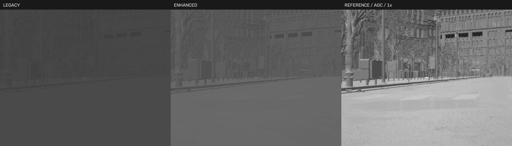

# 实拍参考红外成像试验（2026-10-27）

下一轮已开始材料类别和Avata局部投影热斑试验，独立保留第一版材质，详见[材料热像试验](INFRARED_MATERIAL_PILOT.md)。以下验证数字和未完成项描述第一轮状态，不应当覆盖后续报告。局部投影增加不代表真实电机网格分割或物理温度已完成。

目标是先改善无人机热像的可用外观：640×512 原生输出、小目标随视角变化的像素形态、热斑分布、光学模糊、平滑增益和运行后的升温/冷却。用户提供的四幅实拍拼图用于视觉参照；其中含标注框、文字和放大插图，没有当作原始热像测量数据，也没有加入公开代码库。

本阶段不需要逐栋重做城市模型。先保留地图几何和可见光材质，用独立红外链路迭代。真实温度、发射率和大气标定留待获得原始相机序列与设备参数后进行。

## 本次实现

新增独立材质 `/Game/WISEYE/Sensors/M_IR_Reference`，在界面选择“实拍参考 · 试验版”。原始、增强两种公式继续保留，支持同一视角对照；新资产不存在时按能力回退。

参考模式的链路为：

```text
城市/目标几何 → 归一化热信号代理 → FP16 采集
→ 可选 2× 采样合并 → 原生像素 Gaussian PSF
→ 百分位平滑 AGC → 对比/白热黑热 → 640×512 显示、PNG、JPEG
```

- 参考模式关闭红外采集的 TAA 和运动模糊；模糊在最终红外像素尺度处理，避免简单把可见光锐边染白。
- AGC 使用 256 桶直方图的 2%/98% 分位，增加余量和最小窗口，并按时间常数平滑适应。首次有效帧立即建立窗口。关闭 AGC 时使用固定 0～1 窗口。
- 每架拥有者用新鲜的四电机 RPM 构造功率代理，驱动不同时间常数的电机与电池升温/冷却。丢失 RPM 时趋向冷却。数值是工程近似，不是摄氏度；当前电机部件分组沿用 Mavic 的已有网格名称，Avata 尚未单独划分电机网格。
- 电池热斑是限制在机身掩码内的投影 Gaussian 近似，并没有新增真实电池网格或修改模型尺寸。
- 输出图像经 CPU 后台线程处理，再回传显示纹理；UE 光学视图、HUD、PNG 和 JPEG 共用该处理结果。不是全 GPU 成像管线，也没有额外新增一次全场景采集。
- 继续使用现有 CustomDepth/Stencil 的可见性链路；没有实现独立热掩码或证明与任意第三方实例分割方案兼容。
- 背景仍为法线、弱可见光纹理与距离衰减代理，没有给整座城市建立温度/发射率材料库。

## 使用与参数

本轮是源码/Editor 试验；已经交付的 20261027 城市 Shipping ZIP 不会自动包含这些改动。

本机旧 E 工程已由用户自行清理。新建的 `E:\Projects\WISEYE-IR-Work` 是最小化原生构建与测试工程，唯一开发源码仍在 `F:\WISEYE-Studio`。城市大资产复用本机 `E:\Projects\Scene\CitySample`；不能把这个联接工程直接拷到另一台电脑当作完整发布物。

```powershell
powershell.exe -NoProfile -ExecutionPolicy Bypass -File "F:\WISEYE-Studio\scripts\Start-InfraredPreview.ps1"
```

脚本默认使用新 E 工程，运行数据放在其 `preview-data`，桌面和飞控从 F 的源码/环境启动。首次复制独立设备配置，不覆盖正式 Fleet。等待城市加载完成，桌面连接 UE，选择云台的红外属性页。

| 参数 | 建议起点 | 含义 |
|---|---|---|
| 成像模式 | 实拍参考 | 新读出链路；另两种用于对照 |
| 自动增益 | 开 | 稳定灰度窗口；快速转向后需要适应时间 |
| 增益适应时间 | 1 秒 | 0.1～10 秒，越大越慢 |
| 红外采样 | 1× | 默认；2×为更高采集开销的可选试验，最终仍640×512 |
| 光学模糊 | 0.8 px | 0～2，过大可能抹掉微小目标 |
| 明暗对比 | 1.35 | 0.3～3，过大会削平热斑细节 |
| 背景层次 | 0.65 | 0～1，当前仍是结构代理 |
| 噪声 | 0.008 | 外观参数，不对应已测 NETD |

以上按云台隔离，本次运行有效。应用后等待至少三个新帧，比较 AGC 时建议再等数个适应时间。保存的 PNG 附带模式、AGC、采样、模糊、对比和噪声参数；它仍是显示灰度图，不是原始辐射数据。

性能预算不足时先保持 1×。2× 将红外光栅采集和 FP16 读回的像素数提高到四倍，不保证小目标在所有距离都改善。

## 验证方法

`tests/native/test_thermal_math.cpp` 对真正被 UE 引用的热状态和 AGC 数学做不变量测试，包含时间步长一致性、增温/冷却、异常输入、增益窗口与极性互补。

真实运行检查入口：

```powershell
Set-Location F:\WISEYE-Studio
& .\builds\python-env\Scripts\python.exe -X utf8 tests\verify_infrared_reference_live.py --device ptz-02 --output E:\Projects\WISEYE-IR-Work\evidence\manual-check --flight
```

需要新版 UE 与飞控已连接，起始无人机落地。建议仅在独立测试数据目录使用；`--flight` 会执行真实起飞/降落和短时间升温/冷却测试。检查在 `finally` 恢复云台参数和跟踪设置；进程中断时仍应人工确认已降落。

图像验证包含模式对照、黑白热、固定/自动增益、1×/2×、非法请求原子拒绝、原始尺寸、PNG/JPEG一致性与不同 FOV 下目标角尺寸。改变 FOV 的检查不是距离扫描。短时 `cache_age_ms` 也不是采集至桌面显示的端到端延迟。

## 本机实际结果

UE5.8.4 Editor Development 最终构建成功。54项核心、16项Qt检查及原生热模型不变量通过。真实 Small City、1架 Mavic + 2云台、节能档、ptz-02 完整接口与一次起降验收通过，见 [机器报告](evidence/infrared-reference-20261027/report.json)；这是短测，不是长期/多机/独立包验收。

| 最终一轮各约8秒 | UE Tick Hz | IR新帧 Hz | 源缓存年龄中位/P95 ms | CPU读出中位/P95 ms |
|---|---:|---:|---:|---:|
| 原始模式 | 30.00 | 9.96 | 133 / 166 | 不适用 |
| 参考1× | 29.87 | 9.96 | 134 / 181 | 10.36 / 15.22 |
| 参考2× | 25.69 | 8.52 | 231 / 302 | 11.11 / 14.93 |

前一轮相同最终二进制的短测曾得到原始65/108ms、参考1×166/200ms、参考2×232/295ms，提取记录在 `performance-repeat.json`。缓存年龄受采样相位和排队影响，不能从一次短测推导固定的新增延迟；两轮均说明2×开销较高。没有在本轮测完整桌面或跨机RTSP延迟。默认1×，没有宣称处理免费。

- IR始终640×512、VIS1920×1080，拒绝空白/恒定灰度图。白热/黑热互补平均误差1.33灰度级；PNG/JPEG平均差2.09级。不同时间采样与JPEG压缩均会产生误差，这不是热辐射精度。
- 5种非法新参数拒绝且不改变已确认配置，包含数值冒充布尔、越界适应时间和非1/2采样倍率。首次实测发现UE的宽松布尔转换，已增加JSON类型检查并重新编译、完整重跑通过。
- 8°、25°、80°视场图像已保存，反映目标角尺寸变化；没有改变无人机实际尺寸，没有完成多距离/多背景数据集校准。
- 起飞稳定运行后 motor_warmth 从0升至0.13179、battery_warmth升至0.04763；降落停机后电机状态约0.14870，10秒后降至0.11164，电池由0.06661降至0.06080。均为归一化代理，不是摄氏度。检查确认落地RPM归零，结束恢复参数。
- 最终报告18:50:59写入，随后18:51:23收到 `Win RequestExit`、UE正常退出；测试进程守护清理飞控。当前50051/50052均未占用，没有将两小时交互间隔算作稳定性测试。
- 原始 `M_IR_Minimal` SHA256保持 `675a01fd4f6df7540a7ceef093e0ccd98393e63d1409fbb6021705ca6f257b47`；用户city Fleet保持 `bc48982ddb6043eca0fb6dbf7a4d61a249e8b15918590e8df2188b9587fb2fa6`。未更新GitHub或Shipping ZIP。



图像显示参考模式层次和对比变化，但城市墙面/植被仍偏细碎，热目标可能饱和，不能据此认定与Anti-UAV同分布。`parameters.png` 是用本次真实回读参数渲染的Qt属性页，不是另一次完整桌面控制验收。

测试工程使用内部盘原始城市资源的目录联接，避免F盘再次出现USB重置时继续高负荷扫描。本轮记录到F盘disk153/UASPStor129，停止了首次F资产扫描后才切至内部盘。衍生城市中6个自动人群/交通/昼夜控制Actor标记为EditorOnly并保存，复测未再出现这些自动系统；不修改用户F城市副本或原始CitySample。首次新的用户目录扫描全部城市资源约需数分钟。

## 下一阶段

1. 在固定航线/距离/视场角下采集城市、天空等背景的动态视频，记录目标像素宽高、局部目标背景对比与运动拖影。
2. 对 Avata 补充电机区域；对城市先做道路、墙面、玻璃、植被、天空等少量热类别和昼夜预设，无需重建几何。逐项检查遮挡和多目标归属。
3. 获得无框、无字幕的原始实拍序列及 FOV/距离/极性/曝光资料，拟合目标尺寸、PSF、噪声与增益变化；当前拼图无法推导真实 NETD 或绝对温度。
4. 若 CPU 读出增加的延迟影响使用，将直方图、PSF 与映射迁到 GPU Compute，再验收相同分辨率下端到端延迟与多云台开销。
5. 上述参数稳定后再重新 Cook/打包并做独立运行验收；本轮没有采购或安装第三方红外插件。
