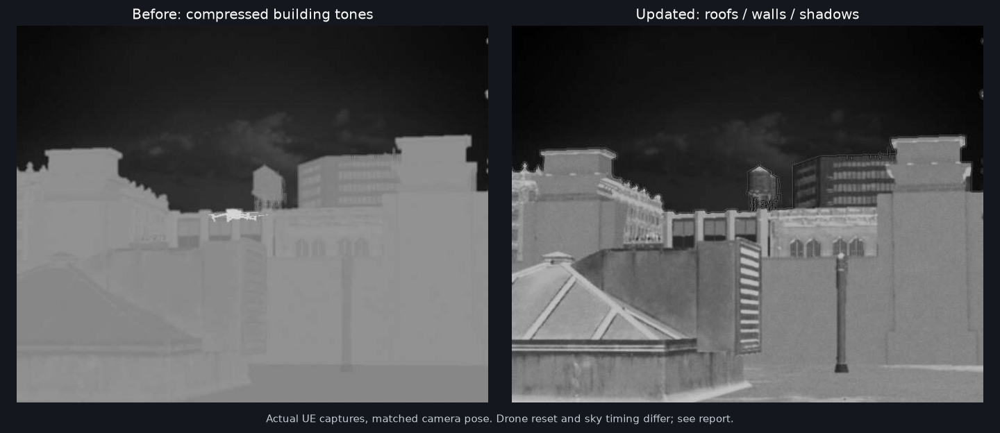

# 读取失败、红外对比与训练端入口修复（2026-10-28）

本轮按用户实际截图修复，源码仍在F，运行构建仍在`E:\Projects\WISEYE-IR-Work`。旧独立ZIP没有更新。

## 设备读取与模型预览

`rotation_deg`在UE和清单中为`[pitch,yaw,roll]`。桌面原校验误检查前两项，将合法的`[0,90,0]`偏航判作不支持的倾斜，导致场景编排加载中断、设备列表为空、坐标保留0、放置按钮禁用。原生UE接口能运行不代表桌面能读取，上轮验收漏掉了该路径。

现只约束pitch和roll为0，保留合法yaw，不需要修改用户配置中的90°朝向。新增存取、两个倾斜轴拒绝、桌面加载实际非零坐标/设备列表/放置按钮及请求地址回归。

实际从桌面点击“到UE预览放置”，看到设备模型、第一次左键确认、坐标回到对应设备草稿均已通过；真实设备未移动。使用方式仍是先调整UE自由观察位置，再取点，确认后保存初始布置并加载才生效。

## 红外调整

原0.72背景信号缩放让楼房整体变暗，但没有增加屋顶、墙面和暗部之间的区别。本轮改为：

- 楼宇着色器分开屋顶与立面基础信号，加强法线朝向、粗糙度和现有材质细节；不绘制虚构窗格，不改整城材质。
- 自动增益后展开背景中间灰度，使用平滑肩部限制两端，显示范围约20–214灰度；天空不套用这条背景曲线。
- 目标显示强度乘0.82，限制整机纯白高光，同时保留内部信号变化。先按白热完成映射，再做黑热反转；其他红外模式保持原显示流程。
- 原始归一化信号、目标热状态、GT和记录信号不由显示曲线改写。历史0.72函数仅保留给回放标志1；回放标志2为新曲线，0为原始显示。

实际城市相同相机位置、方向、FOV及参数下，非天空/非目标区域P5–P95由133–147变为71–169，中位144→131。目标是增加层次，不是整幅加亮。用户参考图中手选楼宇主导区域P5/中位/P95约36/79/168；参考建筑、材质、环境与仿真不同，不宣称直方图或真实温度已经匹配。

此比较跨重启，云层时间不同；重启前无人机已被手动移到别处，重启后回到配置起点，因此不能把两图无人机当作同姿态对照。另行真实起飞悬停图中目标区域中位168、P95约172，>235比例为0；掩码与JPEG临近采集，统计不是严格同帧GT测量。图像仍是工程热像代理，尚未进行实机辐射/相机标定。

## 打开训练端

主界面右上角新增“打开训练端”，不需要离开仿真手动找VBS。当前仿真已连接时，传入仿真主机、所选云台ID和默认数据端口50100，并自动连接；未连接仿真时也可打开，在训练端填写地址后连接。端口仍可在训练端修改。

已打开时切换到原窗口，启动过程中防重复创建。通过pythonw和CREATE_NO_WINDOW启动，无额外命令行窗口；训练端独立运行，关闭桌面不会主动结束训练。原`training_client/Start-Training.vbs`入口仍可用。

此入口已在源码环境验证。独立发布包需要另包含`Training/WISEYE-Training.exe`才能使用；缺失时明确提示，旧ZIP不因此自动获得训练端。

## 已执行验证

- Editor编译和楼宇材质生成成功，更新的Facade资产已从E回传F。
- 73核心、36相关Qt、原生热像数学测试通过；回放工具编译通过。
- 实城run `2C45EBCE4E2B09152A6177AC2AF2B6B5`：桌面读取2设备/非零坐标、启用预览、第一次左键确认且只改草稿；按钮打开训练端、自动接收双路、重复点击复用窗口通过。
- Mavic真实起飞/悬停/降落、真实RPM和双路GT通过，结束ready/四RPM0。自有测试进程已退出。
- 证据`docs/evidence/placement-tone-training-20261028`，其中本机`ui_flow.py`是依赖隔离数据目录和Win32鼠标操作的诊断脚本，不是日常入口。用户参考图未复制进仓库。

正常启动仍双击根目录`Start-WISEYE-Studio.vbs`；等待UE/飞控就绪后点“连接仿真”。本轮未重包、提交或推送。

验收后已通过根目录VBS重新打开常规预览，使用preview-data，供用户直接查看；未保持隔离测试进程。常规启动后又复核可见的场景编排页与训练端按钮流程通过，见ui-flow.json与restored-normal-preview.json。主界面若显示未连接，点“连接仿真”，无需再重复启动UE。
