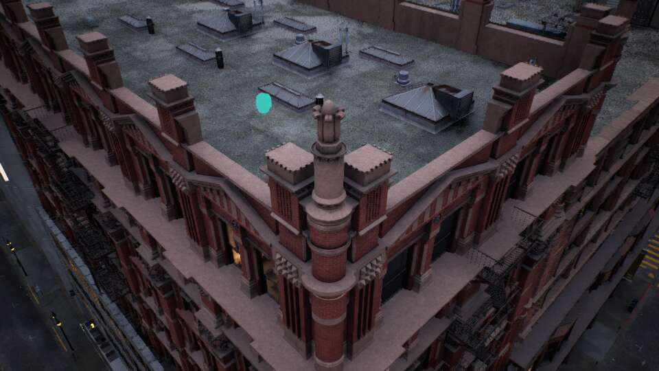
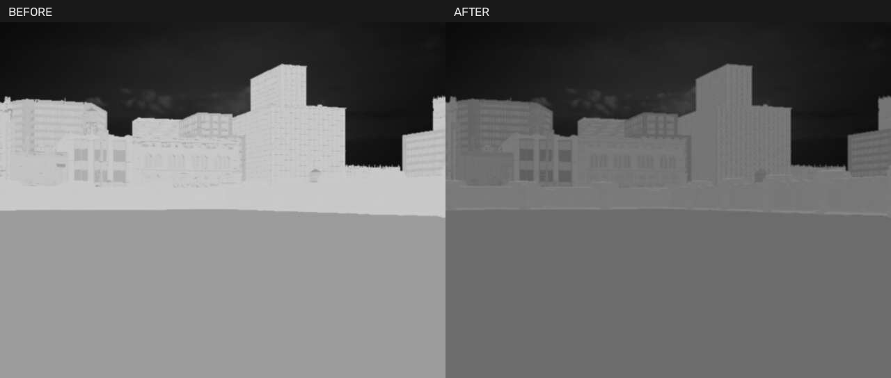

# 启动、屋顶角位与模型放置预览（2026-10-28）

后续用户实测修复见[读取失败/红外对比/训练启动](PLACEMENT_TONE_TRAINING_FIX.md)：yaw90校验已纠正并通过桌面实测；下方0.72背景信号缩放为上一版本历史，新版改为AGC后的背景平滑对比曲线与目标高光压缩。

当前源码在 `F:\WISEYE-Studio`，本机可执行构建在 `E:\Projects\WISEYE-IR-Work`。本轮已更新两处相关源码、配置和材质；旧20261027 ZIP没有更新，不包含下列改动。

## 怎么使用模型预览

1. 双击根目录 `Start-WISEYE-Studio.vbs`，等待城市与飞控就绪，再连接系统。已经开着旧预览的，先降落并正常关闭旧预览，再重新启动。
2. 在 UE 自由观察视角先靠近要放置的屋顶或地面。放置过程中鼠标用于取点，右键用于取消；需要调整观察视角时先取消。
3. 系统“场景编排 → 模型预览放置”，选择已经加载的设备，设置距表面高度，点击“到 UE 预览放置”。新增加的设备须先保存并加载到 UE。
4. 鼠标移入 UE：青绿色半透明模型随鼠标贴合朝上表面，沿用该设备当前尺寸和朝向。系统同时显示预览的 X/Y/Z，单位米。未命中碰撞表面、表面过陡或鼠标离开视口时隐藏模型。
5. 左键确认，位置只写入草稿；右键或界面取消按钮退出，45秒自动超时。确认后仍需保存初始布置并加载场景，真实设备才移动。

云台按实际外壳最低点校正底座，无人机默认距表面0.25m。预览与确认共用同一个坐标计算。预览保留当前姿态，不会自动贴合斜坡旋转，也没有增加旋转操纵器或整机占地碰撞检查。预览被场景遮挡时不会透墙显示，请先换观察角度；射线采用城市实际碰撞，复杂装饰物的渲染轮廓可能与碰撞不完全一致。

模型只出现在操作观察画面，不加入可见光、红外及其训练深度/标注采集；无碰撞、无阴影、不写自定义深度。退出时销毁模型并解除传感器隐藏引用。Nanite源资产不改，只有半透明预览副本使用普通网格回退；材质用曝光补偿保持白天颜色可见。

## 同轮其他改动

- **启动**：UE源码确认Editor以`-game`运行默认同步扫描全部源资源，而且不写入资源扫描缓存。`[AssetRegistry] EditorGameScansAR=False`取消该预览模式的启动全量扫描，运行依赖地图及显式资产路径加载；正常编辑器和Cook保留正常扫描。本机三次引擎初始化42.23、30.72、29.93秒；此前记录136.49秒。不是严格冷缓存A/B，也不是桌面、飞控全部就绪的耗时；首次编译材质仍可能更慢。
- **角位**：城市仍为1架Mavic、1套双光云台。云台锚点`(-27066.552734375,-2092.68798828125,4059.1168165)`cm，楼面z4055cm，距两条碰撞楼边各100cm；底座周围±35cm九点同高。无人机移到同屋顶开阔区域`(-27400,-2600,4080)`cm，周围±100cm九点同高。原远处起点被屋顶结构遮挡，已重新选择，不关闭遮挡或碰撞规则。
- **界面**：窗口显示名WISEYE，保留内部`test`模块和`/Script/test`路径。移除UE文字HUD及屏幕调试提示，保留画面缩略窗、取点十字；日志与桌面状态仍保留。光追警告使用自身屏幕提示开关关闭，不靠增大内存预算掩盖。
- **红外**：默认楼宇`facade`模式、contrast1.1、稳定增益。降低墙体基础信号，保留屋顶/立面纹理与朝向变化；AGC后背景显示幅度乘0.72，天空和目标掩码不参与该压缩。其他红外模式保留。这是外观代理优化，未增加物理温度/发射率/大气标定。

同一旧机位、同参数、手动增益固定的实际截图中，建筑几何区域中位灰度193→111、P95 201→122；原图并没有>235灰度饱和，不能称为修复了过曝截断。亮度更接近参考观感，但不等于实拍相机定量匹配。换到新角位后不沿用旧机位统计做比较。

## 验证与复现

Editor编译成功，核心72项、相关Qt35项通过；界面最后改动后取点Qt5项再次通过。原生热像数学测试通过、回放工具编译通过。实际城市云台/Mavic/Avata预览的移动、尺寸、左键确认坐标一致、离窗隐藏、右键取消均通过。模型尺寸实测：云台含附件包围盒高约81.8cm，Mavic含桨约43.7×43.8×10.77cm，Avata18×18×8cm；包围盒不替代模型尺寸标定。

角位Mavic真实起飞/悬停/降落、四电机真实RPM、双路各自GT均通过（run_id `AB3F783249EA9AF0F2035E917A6E9B50`）。最终颜色预览会话`FA431E364FD3C90E22FAD5A9D18F9320`完成后已恢复Mavic、ready、四RPM0，并退出自有进程。

证据在`docs/evidence/startup-corner-tone-20261028`：`placement-preview.json`、截图、`corner-selection.json`、`drone-surface.json`、`corner-flight-final/report.json`、`tone-comparison.json`、`startup-records.json`、`final-state.json`。`placement-live-harness.py`是本机已执行的诊断记录，使用Win32移动鼠标，依赖该隔离测试数据目录，不是日常启动入口。

后续再做：放置旋转操纵器/占地冲突提示；真实热红外数据标定；重新Cook独立包。此轮未打包、提交或推送。
